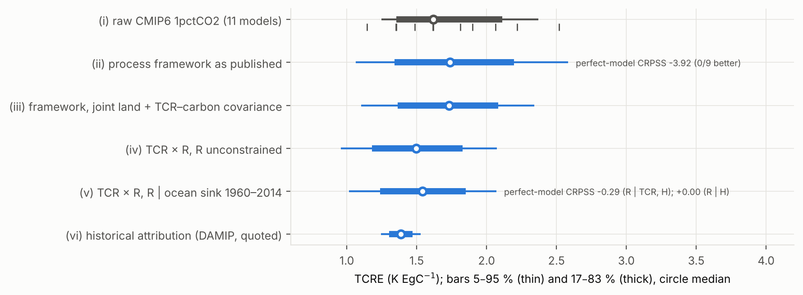

# Results summary: TCRE lines-of-evidence testbed

Status as of 2026-10-22 (M0 to M11). Every number below is produced by the script named in its section, from files in `data/` with fixed seeds; the JSON/CSV files in `results/` hold the full values. Findings describe the behaviour of methods and inputs; they are not conclusions about the authors of the upstream framework, and they should be checked with Ben before being communicated.

Conventions: β in PgC ppm⁻¹, γ in PgC K⁻¹, α in K ppm⁻¹, TCRE in K EgC⁻¹, R = TCRE / TCR in EgC⁻¹. "COU−BGC" is the C4MIP convention (Arora et al. 2020 2×2 solve); "RAD" uses 1pctCO2-rad; ε = ΔC_COU − ΔC_BGC − ΔC_RAD. Default diagnosis: esm-deck C4MIP global means, 20-year mean over simulation years 61–80 (2×CO₂), temperature and carbon fluxes relative to a linear fit of piControl.

## Overview

Main findings, in order of weight for the TCRE assessment:

1. **The framework's real-world estimate does not recover a CMIP model's TCRE when that model plays the real world (A4).** Leaving each of 9 models out and using its own observables, the reported TCRE lies above the held-out value in 9 of 9 cases, by 0.43 K EgC⁻¹ on average (about 25 %); CRPS skill against the raw ensemble is −3.9. Predicting with the held-out model's own process flags removes most of the bias but gives intervals about four times wider than the ensemble, still without skill (−0.96).
2. **The offset is set mainly by the "all processes on" construction and its priors, not by the emergent constraints (A5, A6).** Against the TCRE implied by the CMIP6 input means (1.55 at TCR 1.7 K), the posterior means give 1.74; 86 % of the denominator change comes from the lower β_L (nitrogen-limitation factor applied to all models), 36 % from the more negative γ_L (process deltas, chiefly permafrost), offset by −24 % from β_O. In synthetic tests δ_permafrost returns its prior median whether the true effect is −30 or 0, δ_fire and δ_veg are not identified, and an interaction (ε) effect is attributed to a direct nitrogen effect on γ. The ocean emergent constraint is neutral out of sample; γ_O is prior-dominated.
3. **TCR carries about 90 % of the cross-model TCRE variance; the carbon factor R = TCRE/TCR varies by 6 % (A2, B).** The carbon-cycle machinery mainly moves the central estimate.
4. **The convention problem is real for attribution but small for reconstruction at 2×CO₂ (A1, A2, A7).** The "β dominates the carbon-term spread" ranking survives all three allocations of ε, but the size of the split changes. RAD-based reconstruction is unbiased on average (+0.02 K EgC⁻¹), with model-specific errors (ACCESS +0.16). γ is not transferable across forcing levels: β falls from 2× to 4×, so 2× parameters underpredict 4× TCRE by 11 %, and the C4MIP γ_O roughly doubles while γ_O(RAD) barely changes, because ε_O scales with ΔCa·ΔT.
5. **Covariance (M1, A3).** The HANDOVER §2.3 covariance results reproduce only with a misaligned hard-coded α array; with consistent inputs, discarding covariance inflates both tails rather than truncating the upper one. In the framework's structure, fitting β_L and γ_L jointly changes nothing; imposing the cross-model TCR–carbon rank correlation lowers the 95th percentile from 2.58 to 2.35 K EgC⁻¹.
6. **The convention-free line (B).** With the upstream TCR prior, TCR × R gives 1.50 [0.96, 2.07] K EgC⁻¹ (mean, 5–95 %); with an AR6-like TCR, 1.59 [1.03, 2.18]. No 1960–2014 observable (ocean sink, net land flux, fossil airborne fraction) shows perfect-model skill for R, even with perfect observations; the historical constraint moves the estimate by +0.04.
7. **Reproducibility of the upstream code (M0).** The pinned commit does not run; a names-only patch reproduces the notebook headline (1.771 against 1.766).

## M0. Upstream reproduction (`scripts/m0_reproduce_upstream.py`)

- At the pinned commit (98c74cb) the land builders do not construct (TypeError in `build_beta_land_model`; duplicate variable names in `build_gamma_land_model`; `add_emergent_constraint` reads a variable that is never created). The saved notebook output lists variable names that only exist in a version with `var_name`-prefixed internals, so the published headline was produced with code that differs from the commit.
- A minimal patch (names only; priors, likelihoods and structure unchanged; exact diff in `src/tcre_evidence/upstream_patched/upstream.diff`) reproduces the headline: TCRE mean 1.771 (sd across 3 seeds 0.002), 95 % HDI [0.903, 2.714], against the notebook's 1.766 [0.927, 2.737]. All fits r̂ < 1.004, bulk ESS > 1600, no divergences (PyMC 5.28.5, 4 × 1000 draws, target_accept 0.99).

## M1. Upstream inputs and the §2.3 covariance table (`scripts/m1_covariance_check.py`)

- The HANDOVER §2.3 numbers are reproduced exactly by bootstrap recombination of the 11 land∩ocean models (regression tests in `tests/test_covariance.py`).
- The hard-coded α array in the notebook's CMIP reference does not follow the `np.intersect1d` model order it is paired with: it follows the order of the 11 models that have α in the sheet (which include BCC-CSM2-MR and CNRM-ESM2-1, not in the common set). Six of the nine checkable models receive another model's α; CMCC-ESM2 and EC-Earth3-CC have no α.
- With α matched by name (9 models): corr(α, α·γ) changes from −0.53 to +0.28 and corr(α, β_O) from +0.52 to −0.02; paired recombination gives a narrower upper tail (95th percentile 2.35) than upstream-style recombination (2.58). The §2.3 statements that high-TCR models lose more carbon and that independent recombination truncates the upper tail depend on the misalignment.
- The notebook's posteriors use the sheet values, its CMIP reference uses the CSV/Terhaar files; these differ by up to about 4 PgC K⁻¹ in γ_L and 1.5 PgC K⁻¹ in γ_O.

## M2 / A1. Harmonised feedbacks and closure (`scripts/m2_feedbacks_closure.py`)

- Reader for the esm-deck C4MIP files with an explicit per-model sign, unit and format table and assertions (`src/tcre_evidence/c4mip.py`). Data issues handled: mixed flux signs; UKESM forced runs in K but piControl in °C with a different header; CNRM BGC/RAD runs 10 years shorter; CNRM piControl CO₂ missing; MIROC (JAMSTEC) piControl CO₂ column holds the 1 %/yr ramp.
- 11 models, 2×CO₂: TCRE 1.74 ± 0.41 K EgC⁻¹; TCR 1.96 (CV 23 %); R = 0.884 EgC⁻¹ (CV 6 %); AF 0.533.
- HANDOVER §2.4 is reproduced with its first-10-year baseline (TCRE 1.70 ± 0.36; RAD reconstruction bias +0.009 ± 0.023 in AF and +0.03 ± 0.07 K EgC⁻¹ in TCRE; ACCESS ε_L 116 PgC; CNRM ε_O +49 PgC). With piControl drift correction the CNRM ocean exception disappears (ε_O −10 PgC; its control ocean flux is −0.8 PgC yr⁻¹) and BCC ε_L changes sign (+25 to −33 PgC). ε is sensitive to drift correction.
- COU−BGC reconstruction closes to machine precision (bookkeeping, as expected).
- Convention of upstream inputs: our COU−BGC values correlate with the upstream land CSV at r = 0.96 (β_L) and 0.97 (γ_L), and with the Terhaar ocean file at 0.97 (β_O) and 0.99 (γ_O), against 0.31 for our RAD γ_O. The Terhaar file is COU−BGC despite its "1pctCO2-BGC" attribute.
- Closure of upstream inputs against each model's actual 1pctCO2 TCRE: sheet β, γ with our α reproduce TCRE to 0.012 ± 0.026 K EgC⁻¹; with the sheet's own α the error is 0.03 ± 0.14 (up to 0.23 for IPSL and ACCESS). The notebook's CMIP reference (CSV/Terhaar with hard-coded α) misses by up to 0.89 K EgC⁻¹ (GFDL), sd 0.47.

## M3 / A2. Convention sensitivity and attribution (`scripts/m3_convention_attribution.py`)

- TCR dominates: 89 % of the cross-model variance of ln TCRE comes from α (94 % with the first-10-year baseline), consistent with HANDOVER §2.5.
- Carbon-term variance (S = β + αγ, exact per-model decomposition) under three allocations of ε, 2×CO₂: the β terms carry 71–84 % by independent shares in all three, and land carries 84–99 %. Covariance shares exceed one for β because β and αγ covary negatively; the C4MIP allocation gives the largest β share (1.41) and COU−RAD the smallest (1.06). The "β dominates" ranking survives the change of convention; the size of the β/γ split does not.
- RAD-based reconstruction at 2×CO₂: AF +0.004 ± 0.019, TCRE +0.018 ± 0.062 K EgC⁻¹; 8 of 11 models within 0.05; ACCESS-ESM1-5 +0.16. The bias is model-specific rather than systematic, and AF is not systematically too low.
- ε_O is negative in all 11 models (−8.8 ± 3.5 PgC at 2×, −50 ± 12 PgC at 4×), consistent with Schwinger et al. (2014). ε_L is +14 ± 38 PgC at 2× (7 of 11 positive) and +48 ± 142 PgC at 4×.

## M3 / A3. Recombination and covariance (`scripts/m3_covariance_rerun.py`)

- Deck models with α, β, γ from the same runs: corr(β_L, γ_L) = −0.82, corr(β, αγ) = −0.84, corr(β_O, γ_O) = −0.71, corr(α, αγ) = +0.42, corr(α, β_O) = −0.28. Independent recombination doubles the sd of AF (0.060 against 0.030 paired, a factor of four in variance, as estimated in HANDOVER §2.3) and widens both TCRE tails: 5–95 % [1.21, 2.65] against [1.15, 2.52] paired. With consistent inputs, discarding covariance inflates rather than truncates the upper tail.

- Upstream pipeline variants (seed 0; `results/m3_covariance.json`, `fig_m3_covariance.png`):

  | variant | TCRE mean ± sd | 5–95 % | 95 % HDI |
  |---|---|---|---|
  | U, as published | 1.77 ± 0.47 | 1.07–2.58 | 0.90–2.71 |
  | J, joint land model (correlated per-model biases) | 1.77 ± 0.46 | 1.07–2.58 | 0.95–2.78 |
  | U + TCR–carbon rank correlation from the deck | 1.74 ± 0.38 | 1.10–2.35 | 1.02–2.51 |
  | J + TCR–carbon rank correlation from the deck | 1.73 ± 0.38 | 1.10–2.34 | 1.01–2.48 |
  | U + TCR–carbon rank correlation from the hard-coded α order | 1.79 ± 0.51 | 1.05–2.68 | 0.84–2.76 |

- Fitting β_L and γ_L jointly does not change the result. The per-model biases are correlated (posterior mean −0.46 between β_L and tropical γ_L, −0.39 with extratropical γ_L), but the framework's reported truth (baseline × Πη + Σδ) excludes the biases, so the posterior correlation of the land truths is 0.01 to 0.04 either way. In this structure the cross-model β–γ covariance does not reach the TCRE estimate. (Joint fit: r̂ 1.001, bulk ESS > 2500, 8 divergences in 4000 draws.)
- Retaining the TCR–carbon covariance does matter: imposing the deck's cross-model rank correlations (TCR–β −0.15, TCR–γ +0.56 [90 % CI 0.06, 0.84], β–γ −0.44; n = 11) on the TCR prior and carbon posteriors lowers the 95th percentile from 2.58 to 2.35 and the HDI upper bound from 2.71 to 2.51. With the misaligned hard-coded α the same procedure moves the upper tail the other way.
- Which covariances survive substituting the assessed TCR: only TCR–γ is distinguishable from zero across 11 models, and only at the 90 % level. Imposing it assumes the cross-model relationship reflects a physical link that also holds for the real world; it is reported as a sensitivity, not a preferred estimate.

## M4 / A4. Perfect-model test of the upstream framework (`scripts/m4_perfect_model.py`)

- Setup: 9 target models with an actual 1pctCO2 TCRE and ocean predictors (ACCESS-ESM1-5, CESM2, CanESM5, GFDL-ESM4, IPSL-CM6A-LR, MIROC-ES2L, MPI-ESM1-2-LR, NorESM2-LM, UKESM1-0-LL). For each, the model (or its family) is removed from the land, IAV and ocean training data and from the paired nitrogen experiments; its own γ_IAV, AMOC, SSS and CUC replace the observations (with the real observational σ; IPSL has no simulated IAV, so that constraint is made uninformative); the three upstream component models are refitted unchanged; α is the held-out model's own ΔT/ΔCa, for the framework and the baselines alike, so the test isolates the carbon-cycle part. Baselines: Gaussian of the training models' R times the held-out TCR ("raw ensemble"), and a Student-t random-effects predictive. Because R varies by only 6 % across models, these baselines are narrow and hard to beat. All 36 component fits: r̂ ≤ 1.009, no divergences.
- Two framework outputs are scored. (a) The reported truth (baseline × Πη + Σδ, "all processes on"), which is what the framework reports for the real world. (b) A flag-conditional predictive for a new model with the held-out model's own process flags, which tests the process regression out of sample.

  | leave one model out, TCRE | CRPS | CRPSS vs raw | better than raw | 66 % / 90 % coverage | mean bias | mean PIT |
  |---|---|---|---|---|---|---|
  | raw ensemble | 0.057 | 0 | | 0.78 / 1.00 | −0.03 | 0.61 |
  | random effects | 0.057 | | | 0.89 / 1.00 | | |
  | framework, reported truth | 0.278 | −3.9 | 0 / 9 | 0.22 / 0.89 | +0.43 | 0.11 |
  | framework, own flags | 0.111 | −0.96 | 0 / 9 | 0.89 / 1.00 | +0.20 | 0.46 |

  Leave one family out gives the same picture (CRPSS −3.6 and −0.84).
- (a) The reported truth lies above the held-out model's TCRE for all 9 models, by 0.43 K EgC⁻¹ on average (about 25 %; CanESM5 +1.31, UKESM1-0-LL +0.70, IPSL-CM6A-LR +0.54). This is largely by construction: the reported truth adds every process effect, including a permafrost effect whose prior mean is about −50 PgC K⁻¹, to every model. If a CMIP model were the real world, the framework would not recover its TCRE.
- (b) With the model's own flags the predictive is centred (mean PIT 0.46) but much wider than the ensemble (median sd 0.43 against 0.11 K EgC⁻¹) and has no skill. The widest case is CESM2 (5–95 % 1.30–4.76), one of the three models with the permafrost flag.
- Components (leave one model out, CRPSS against the raw training ensemble of the same input values): β_L −0.61 (reported truth) and −0.16 (own flags); γ_L −0.98 and −1.18; β_O −0.05; γ_O −0.10. The ocean emergent constraint is roughly neutral out of sample; the land process models lose skill.

## M5 / Workstream B. TCRE = TCR × R (`scripts/m5_tcr_r.py`)

- Data: CMIP6 historical global means fetched from Pangeo/ESGF with QC (`data/derived/cmip_globalmean/`, availability table there); GCB 2025, NOAA GML, HadCRUT 5.2 in `data/obs/`. Historical observables 1960–2014, defined so that model and observed quantities match (model nbp includes land-use change, so the model airborne fraction is that of fossil emissions): cumulative ocean sink (obs 113 ± 22 PgC; models 77–112), cumulative net land flux (obs 36 ± 27 PgC as the budget residual; models −15 to 110), fossil airborne fraction (obs 0.539 ± 0.027; models 0.47–0.69).
- R varies little across models (0.884 EgC⁻¹, CV 6 %) and is uncorrelated with TCR (r = 0.07, n = 11). Correlations of R with the observables are weak: ocean sink +0.48 (90 % CI −0.09 to +0.82, n = 10), net land −0.10, airborne fraction 0.00.
- Perfect-model test (leave one model out, the held-out model's own H as pseudo-observation, TCR known): no observable improves on the plain ensemble. CRPS skill against the ensemble is +0.00 (ocean), −0.11 (land), −0.17 (airborne fraction); with perfect observations at most +0.03. Conditioning on TCR as well costs about 0.3 in skill (estimating a 3 × 3 covariance from 10 models adds noise when the TCR–R correlation is near zero). Leave-one-family-out gives the same picture.
- Estimates with the upstream TCR prior N(1.7, 0.36): TCR × R unconstrained 1.50 [0.96, 2.07] (mean, 5–95 %); with the ocean-sink constraint 1.54 [1.02, 2.07]. With an AR6-like TCR N(1.8, 0.365): 1.59 [1.03, 2.18] and 1.63 [1.09, 2.17].
- Pathway: TCRE(1pctCO2) − TCRE(flat10) = +0.05 ± 0.09 K EgC⁻¹ (7 models). The historical attribution in the upstream DAMIP notebook (quoted, not rerun; its attribution module is not in the pinned commit) is 1.386 ± 0.087.
- With the same TCR prior, the upstream posterior mean (1.77) implies an effective carbon factor near 1.04 EgC⁻¹, about 2.5 ensemble standard deviations above the CMIP6 R (0.884 ± 0.054). A5 identifies where this comes from.

## M6 / A5. Prior versus data (`scripts/m6_prior_sensitivity.py`)

- Prior predictive against posterior for the reported truths (`results/m6_prior_info.csv`):

  | quantity | prior median (IQR) | posterior mean ± sd | CMIP6 inputs mean ± sd | KL(post ‖ prior) |
  |---|---|---|---|---|
  | β_L | 0.82 (0.81) | 0.74 ± 0.27 | 1.12 ± 0.43 | 0.30 |
  | γ_L | −14 (211) | −52 ± 41 | −26 ± 26 | 0.94 |
  | β_O | 1.01 (0.68) | 1.00 ± 0.13 | 0.90 ± 0.07 | 1.06 |
  | γ_O | −8.9 (3.6) | −9.7 ± 2.4 | −9.0 ± 2.7 | 0.05 |
  | TCRE | 1.46 (0.80) | 1.77 ± 0.48 | | 0.22 |

- γ_O is prior-dominated: its prior (standardised N(0, 1)) is the CMIP distribution itself, and the posterior barely departs from it (IQR ratio 0.89). β_O narrows strongly but is centred on the prior median of exp(θ), 1.0, about 1.4 CMIP standard deviations above the CMIP mean; with tighter regression priors (σ 1 instead of 10) it moves to 1.16.
- Relative to the TCRE implied by the CMIP6 input means (1.55 K EgC⁻¹ at TCR 1.7 K), the posterior means give 1.74 (`results/m6_shift_decomposition.json`). Of the change in the denominator k + β + αγ, 86 % comes from the lower β_L (the reported truth applies all multiplicative process factors, chiefly η_nitrogen ≈ 0.7, to every model), 36 % from the more negative γ_L (process deltas, chiefly permafrost), and −24 % from the higher β_O.
- Sensitivity (one prior changed, other components at default; `results/m6_prior_sensitivity.csv`; all fits r̂ ≤ 1.007, no divergences): TCRE mean 1.77 by default, 1.67 with no permafrost effect, 1.71 and 1.80 with permafrost prior medians of −10 and −60 PgC K⁻¹, 1.89 with wide η priors (σ 1), 1.80 without the nitrogen pseudo-observations, 1.72 with tight ocean regression priors. The 95th percentile ranges from 2.39 (no permafrost) to 2.85 (wide η). Structural-variance and LKJ priors have small effects (≤ 0.02 in the mean).

## M6 / A6. Process identifiability (`scripts/m6_identifiability.py`)

- In the lookup table the permafrost flag is set for exactly three models, CESM2, NorESM2-LM and CMCC-ESM2, which all use the CLM land model and also carry the nitrogen and fire flags. The permafrost effect is therefore not separable from a CLM-family offset in this design.

- Synthetic truth experiments (12 replicates per scenario; data generated on the real 13-model lookup table with model-level process scatter at a quarter of the upstream σ_process_struct, structural biases of 8 PgC K⁻¹ and noise of 5 PgC K⁻¹; refitted with the upstream additive process model and the upstream γ_L priors; all fits r̂ ≤ 1.01, 1 divergence in 36 fits; `results/m6_identifiability.csv`, `fig_m6_identifiability.png`):

  | scenario | δ_N (truth → mean estimate, 90 % coverage) | δ_permafrost | δ_fire | δ_veg |
  |---|---|---|---|---|
  | S1 data from the model's own structure | 10 → 12.4 (100 %) | −30 → −36.4 (100 %) | −5 → −0.5 (100 %) | 5 → 0.1 (100 %) |
  | S2 CLM-family offset ±15, no permafrost effect | 10 → 13.2 (100 %) | 0 → −29.4 (0 %) | −5 → 0.4 | 5 → 0.3 |
  | S3 ε channel, no direct nitrogen effect on γ | 0 → 8.5 (0 %) | −30 → −35.0 | −5 → −0.4 | 5 → −0.1 |

- δ_permafrost returns about −30 PgC K⁻¹ (the prior median) whether the truth is −30 or 0, and absorbs a CLM-family offset; its prior (negative-definite) excludes zero, so a zero effect can never be covered. With three flagged models that share one land model, the design cannot identify it.
- δ_fire and δ_veg shrink to zero with posterior sd equal to the prior sd (about 9 against 10): not identified, though nominally covered because the intervals are wide.
- δ_N is recovered when the data follow the model's structure, but when the nitrogen effect acts on β and reaches γ only through the COU−BGC interaction term (S3), it is attributed to a direct δ_N of +8.5 ± 5.4 with zero coverage. The separate η (β) and δ (γ) parameterisation double-counts the ε channel.
- Paired-experiment ν evidence (computed in upstream `data_utils.load_process_evidence` but not used in the notebook): ν_N = +7.2 (ACCESS-ESM CN−C) and +0.2 (UKESM1-1 ctrl−nonlim), ν_fire = −13.0, ν_veg = +1.2 PgC K⁻¹. Added as pseudo-observations (σ 5) on the summed tropical and extratropical δ_p, they change the real-data posterior of δ_N from 18.4 ± 10.2 to 7.0 ± 2.4 and of δ_fire from 0.6 ± 12.9 to −11.2 ± 4.6, and γ_L from −50.0 to −62.7 PgC K⁻¹ (about +0.04 K EgC⁻¹ in TCRE, first order at TCR 1.7 K). δ_permafrost is unchanged (−29 ± 22): no paired experiment informs it. These experiments come from models already in the ensemble (ACCESS, UKESM).

## M6 / A7. State dependence, 2× to 4×CO₂ (`scripts/m6_state_dependence.py`)

- β falls with forcing level (β_L 1.22 → 1.00, β_O 0.92 → 0.80; 10/11 and 11/11 models), so TCRE at 4× reconstructed from 2× parameters is too low by 0.17 ± 0.08 K EgC⁻¹ (−11 %) under either convention.
- γ_O(COU−BGC) roughly doubles from 2× to 4× (−8.8 → −16.7, 11/11 models) while γ_O(RAD) changes little (−3.7 → −5.0): the drift of the C4MIP ocean γ is almost entirely the interaction term. ε_O / (ΔCa·ΔT) is nearly level-independent (−0.016 and −0.014 PgC ppm⁻¹ K⁻¹; r = 0.91 across models between levels).
- γ_L is more negative at 4× in 9 of 11 models (mean change −10 PgC K⁻¹; upstream CSV −13).

## Comparison (`scripts/m6_comparison.py`)

| line | mean | 5 % | 17 % | 50 % | 83 % | 95 % |
|---|---|---|---|---|---|---|
| (i) raw CMIP6 1pctCO2 (11 models, own TCR) | 1.74 | 1.25 | 1.35 | 1.62 | 2.11 | 2.37 |
| (ii) process framework as published | 1.77 | 1.07 | 1.34 | 1.74 | 2.20 | 2.58 |
| (iii) framework, joint land + TCR–carbon covariance | 1.73 | 1.10 | 1.36 | 1.73 | 2.08 | 2.34 |
| (iv) TCR × R, R unconstrained | 1.50 | 0.96 | 1.18 | 1.49 | 1.83 | 2.07 |
| (v) TCR × R, R conditioned on the 1960–2014 ocean sink | 1.54 | 1.02 | 1.24 | 1.54 | 1.85 | 2.07 |
| (vi) historical attribution (upstream DAMIP notebook output, quoted) | 1.39 | 1.24 | 1.30 | 1.39 | 1.47 | 1.53 |

Lines (ii) to (v) all use TCR ~ N(1.7, 0.36) K; line (i) uses each model's own TCR (mean 1.96 K), so (i) and (iv) differ mainly through TCR, not the carbon factor. The difference between (ii) and (iv), 0.27 K EgC⁻¹ in the mean at the same TCR prior, is the framework's adjustment of the carbon factor above the CMIP6 ensemble (item 2 of the overview). The historical attribution line refers to the realised historical pathway; the 1pctCO2-to-flat10 difference in 7 models is +0.05 ± 0.09 K EgC⁻¹, so most of the gap between (vi) and the 1pctCO2-based lines is not a pathway effect of that kind. Perfect-model skill: (ii) −3.92 (0 of 9 models better than the raw ensemble); (v) −0.29 when R is conditioned on TCR and H, +0.00 when on H alone; (iii) was not tested out of sample.

## M7. Nitrogen flag groups (`scripts/m7_nitrogen_historical.py`)

- esm-deck 1pctCO2 (6 nitrogen-limited against 5 other models): β_L (COU−BGC) 1.04 against 1.43 PgC ppm⁻¹, ratio 0.73 (permutation p 0.05, Welch p 0.10); γ_L −21.7 against −47.8 PgC K⁻¹ (p 0.26); R = TCRE/TCR 0.909 against 0.855, ratio 1.063 (p 0.11). Development sheet β_L (8 against 5): ratio 0.66 (p 0.04).
- Historical 1960–2014 (8 against 4 models): net land flux 42.2 against 37.0 PgC (p 0.84), ocean sink 88.7 against 88.2 PgC; correlation of β_L with the historical land flux 0.24 (n = 10).

## M8. Ensemble size for detection (`scripts/m8_power.py`)

- Residual scatter after the four flags: 28.7 PgC K⁻¹ for γ_L, 0.38 for log β_L. Standard errors with 13 models and models needed for a two-standard-error detection (current flag mix / balanced flags): nitrogen on log β_L (0.32): 0.28, 52 / 28; permafrost on γ_L (30): 34.5, 78 / 20; nitrogen on γ_L (10): 21.0, 234 / 138; fire, vegetation on γ_L (5): 24.1 to 26.4, 1209 to 1456 / 532.
- The calculations are `process_tests.flag_budget` and `detection_power`; `scripts/process_tests.py` runs them on any ensemble.

## M9. Calibration and recalibration (`scripts/m9_tuning_selection.py`)

- Synthetic ensembles on the real nitrogen flags, true η_N = 0.73, 4000 replicates per scenario, recalibration tolerance 20 PgC. Flag-regression η_N: no development effects 0.74; FACE calibration 0.86; recalibration of turnover 1.12; of allocation 1.00; FACE plus turnover recalibration 1.07; turnover recalibration towards a target 25 PgC too high 1.12.
- Bias in R (raw ensemble / all processes on / end to end): no development effects −3.7 / −0.0 / −0.2 %; recalibration with the correct target within ±1 %; target 25 PgC too high −7.9 / −5.5 / −8.1 %.
- Bayesian β_L model check on a few replicates: η_N 0.79 with no development effects, 1.03 with turnover recalibration, 0.98 with FACE plus recalibration (r̂ ≤ 1.006, no divergences).

## M10. The configuration's nitrogen decomposition (`scripts/m10_nitrogen_decomposition.py`)

- Predicted ratio of group-mean R (nitrogen-flagged over other esm-deck models) from the configuration's own process models: 1.075 (5–95 % 1.015 to 1.139) against the observed 1.063; with the paired-experiment ν evidence on γ_L, 1.098 (1.046 to 1.156). η_N = 0.72; δ_N on γ_L 18.6 ± 10.5 PgC K⁻¹ (7.0 ± 2.4 with ν). The pure nitrogen effect on R (flag switched on for every model) is 1.052 with both routes and 1.086 through β_L alone, so δ_N offsets about 40 % of the β_L route.
- Split of the all-processes-on β_L (`--beta-split`): baseline U = 1.22, η_N = 0.72, η_fire = 0.86, η_veg = 0.98; U × η_N = 0.88 (the nitrogen-limited CMIP mean is 0.93), all on 0.74; CMIP mean 1.11. All fits r̂ ≤ 1.002, no divergences.

## M11. Process completeness (`scripts/m11_completeness.py`)

- Residual budget (development-code inputs, 13 models): the four flags explain 20 % of the variance in γ_L (adjusted −0.20, leave-one-out −0.70) and 40 % in log β_L (0.11, −0.35); tropics 0.30 / −0.82, extratropics 0.08 / −0.75. Without BCC-CSM2-MR, γ_L leave-one-out −1.76; esm-deck γ_L (11 models) 0.17 / −0.77. Vegetation-flagged models span −1 to −44 PgC K⁻¹.
- Real-data fit of the single-variable γ_L process model: σ_struct 47 PgC K⁻¹ (prior mean 32), ρ 0.48 (prior 0.50), σ_common 33 [16, 56]; real-world γ_L −47 ± 43 (r̂ 1.005, no divergences).
- Synthetic (20 replicates each): an effect present in the real world only is covered by the 90 % interval in all replicates up to −40 PgC K⁻¹ and in half at −60. An unflagged −20 PgC K⁻¹ effect in 1 or 3 models leaves the flagged δs within 2.2 PgC K⁻¹ and shifts the real-world estimate by −4.7 (3-model case), about its ensemble share. r̂ ≤ 1.004 for reported quantities; 10 divergences in 6 of 60 fits.
- Unrepresented-process term on γ_L added to the configuration posterior: none 1.78 [1.07, 2.61]; N(0, 30) 1.78 [1.07, 2.65]; −|N(0, 10/20/30)| 1.80 / 1.83 / 1.86 with 95th percentile 2.67 / 2.75 / 2.81 K EgC⁻¹.

## Caveats and open items

- Small ensembles throughout: 11 models for the deck feedbacks, 9 to 10 for the perfect-model tests, 7 for flat10. Per-model results are in the CSV files; leave-one-family-out variants use an approximate family table (`src/tcre_evidence/perfect_model.py`).
- The upstream code was patched to run (names only). The DAMIP historical line is quoted from a saved notebook output; its attribution module is not in the pinned commit.
- The Google Sheet is live; the snapshot is dated 2026-10-13 and matches the notebook's saved inputs.
- piControl alignment assumes each forced run branches at the start of the supplied control segment, with a linear drift fit; ε is sensitive to this (CNRM, BCC). Historical ocean baselines use the piControl mean or, where it disagrees with the early historical state (MIROC), the 1850–1869 mean.
- The 4×CO₂ window is 10 years (simulation years 131–140) because three models stop at year 140.
- In A4, α is the held-out model's own value so that only the carbon-cycle part is tested; the framework's TCR prior is not part of the test. The IAV constraint is uninformative for IPSL (no simulated value).
- In B, observational uncertainties are GCB 1σ ranges assumed fully correlated in time; the land and airborne-fraction observables depend on the definitional match between model nbp and the budget residual. The historical observables are 1960–2014 cumulative quantities; the target-matched AF–cumulative-emissions approach of Séférian et al. was not implemented.
- The joint land model (A3) had 8 divergences in 4000 draws (r̂ 1.001, ESS > 2500).
- Open items: A4 at 4×CO₂ and with upstream 4× inputs (A7 covered the deck side only); more models for B (Pangeo lacks Lmon nbp for most 1pctCO2 runs, so R is available only for the 11 deck models); flat10 target for A4; GISS and BCC fgco2 unit problems on Pangeo; an IPSL γ_IAV value.
